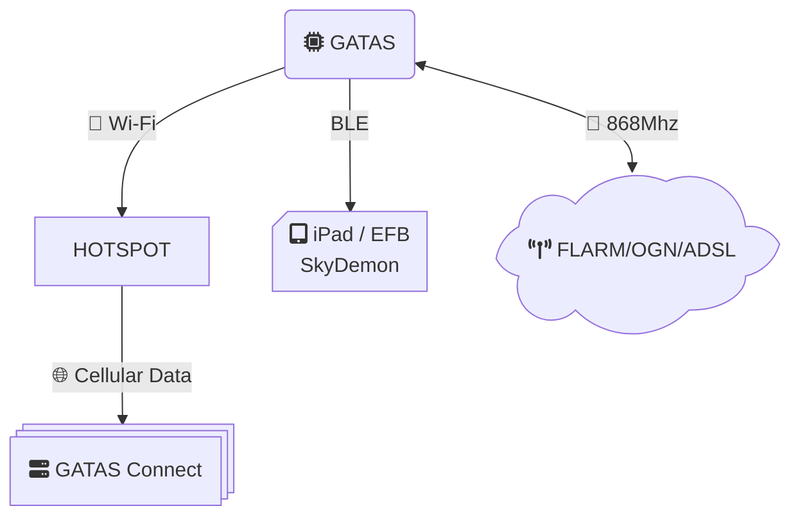
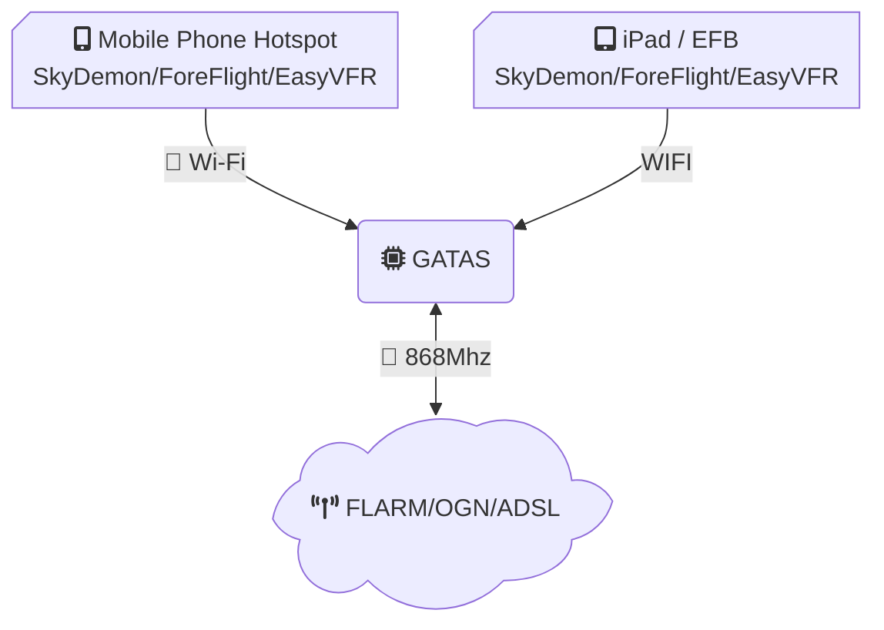
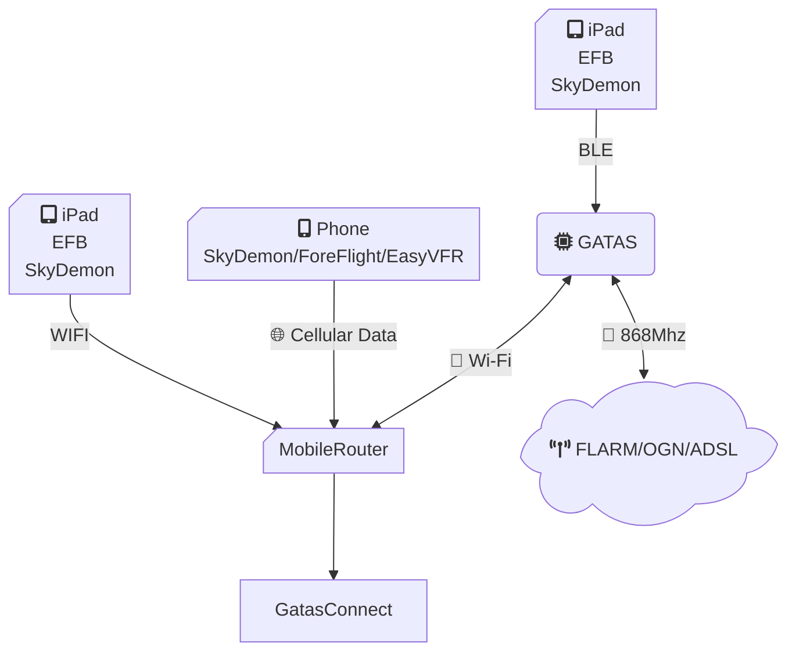
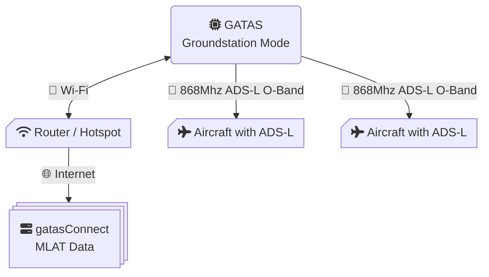
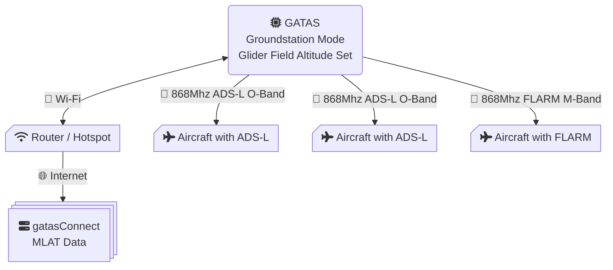

# GATAS PULSE Builder's Guide

This guide provides step-by-step instructions for setting up GATAS.

> **Tip**
>
> It's highly recommended to also have the status Led connected, it will give you install feedback on some of the basic state of GATAS.
>
## Use case 1: You want to receive additional traffic data via gatas Connect, you have your EFB running on your phone

### Setup

1) In GATAS under WIFI Service add your mobile phone's hotspot under *Client Configuration*.

> **Tip**
>
> In Additional to my phone's hotspot I also add my WIFI Network at home so I can configure GATAS on my webbrowser on my computer. Since GATAS will try connect to any available network in the list. Once a connect drops, it will try other networks seemlessly. When I just drive away from home, it will connect to my hotspot.
>
2) Enable gatasConnect module

3) Configure gatas Connect with a pincode. 

> **Note**
>
> **iPhone Limitations**
> iPhones use connection isolation when used as a hotspot this means that unfortunately we cannot provide GDL90 data to an other device connected to the hotspot.
> However, if the other device supports Bluetooth BLE, you can use that to provide NMEA data to your EFB, SkyDemon allows you to do this.
>
>
## Use case 2: GATAS used as hotspot, mobile phone connects to GATAS

1) Keep the GATAS Access Point with default SSID or configure a new name and password.

> **Warning**
>
> **No Internet ADS-B**
> In this situation GATAS will not provide any internet traffic data for MLAT and ADSB-OUT
>
## Use case 3: Mobile router used as hotspot, GATAS connects to hotspot, Mobile Phone connects to hotspot.

Setup is exactly as in **Use case 1**

## Use case 4: Groundstation mode

In groundstation mode, GATAS is installed at an airfield and acts as a stationary transmitter. It receives traffic data via gatasConnect (typically MLAT data) over Wi-Fi and rebroadcasts it over ADS-L O-Band for up to 10 aircraft in the vicinity.

### Regular airfield

At a regular airfield, the groundstation receives internet traffic data and transmits it over ADS-L so that nearby aircraft equipped with ADS-L receivers can benefit from this data.

### Setup

1) Connect GATAS to a Wi-Fi network with internet access under *Client Configuration* in the WIFI Service.

2) Enable the gatasConnect module and configure it with a pincode.

3) Enable groundstation mode.

### Glider field

For glider fields, the groundstation works the same way but adds an important safety feature: you can configure an *altitude* to indicate the operating height of the glider field. This broadcasts a warning to surrounding traffic that a glider field is active at that location and altitude. This will be send over all enabled Procols (FANET/OGN/FLARM and ADS-L)

### Setup

1) Follow the same setup steps as for a regular airfield groundstation.

2) Configure the glider field altitude to indicate the operating height.

> **Tip**
>
> Setting the altitude broadcasts a warning to surrounding traffic that a glider field is active, helping pilots avoid the area or exercise extra caution.
